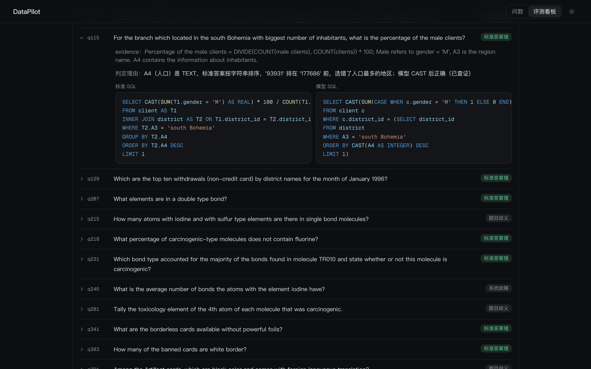
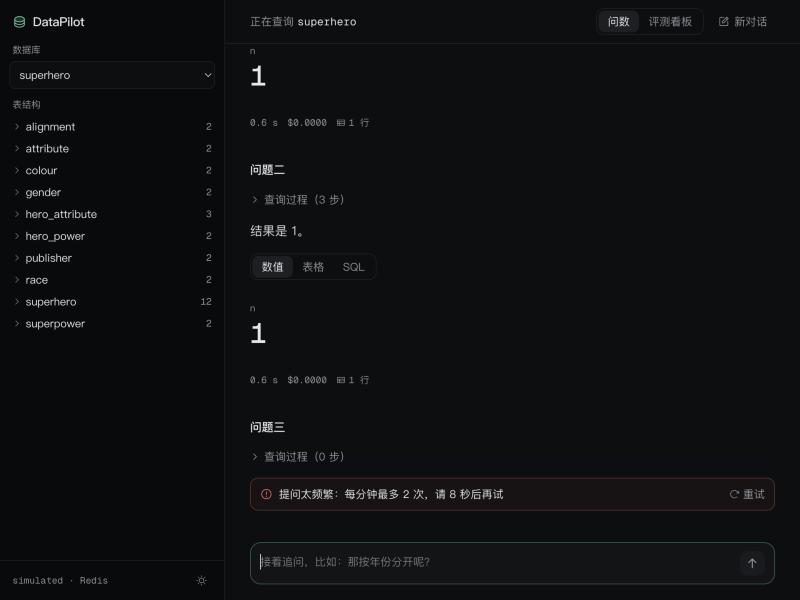

# DataPilot：ChatBI 智能问数

用中文提问，系统读表结构、写 SQL、在只读库上执行，出错时带着报错自动修正，最后给出答案、SQL、可排序表格和自动选择的图表，支持追问。附带一个评测看板，展示在 BIRD Mini-Dev 上的完整实验结果。


| Haiku 执行准确率 | 失败题中标准答案错 | 缓存命中延迟（P50） |
|---|---|---|
| **63.0% → 68.0%** | **56%** | **0.9 ms**（未命中 3.71 s） |
| 取值核对 + 执行纠错，McNemar p=0.008，3 次均值 | 50 道失败题分层抽样、人工判定；审计论文报告 52.8% | 构造请求下重复问题命中 98.3% |




## 诚实边界

- 数据库和问题来自公开基准 **BIRD Mini-Dev**，不是某家公司的生产数据；个人项目，没有真实用户。
- **Opus 的分数疑似受训练数据污染**：500 条预测里 241 条与标准答案逐字相同，不当作能力结论（`docs/问题日志.md` P7）。
- 缓存实测的请求分布是**构造的**（140 道不重复 + 60 次重复），不是真实流量。
- 并发压测用的是**模拟模型**（固定延迟、不调 API），测的是服务端自身；客户端与服务端同机，吞吐在两次运行间相差近一倍。用户身份是前端生成的匿名 id，客户端每次换一个就能绕过限流；要真正防滥用需要网关校验身份。
- "真实准确率约 90%" 是由 50 道人工判定外推的**估计**，不是实测。

## 架构

```
浏览器（Next.js + shadcn/ui + ECharts，深色优先，中文界面）
  │  SSE：步骤进度 → SQL → 表格 → 图表 → 回答（15 秒心跳）
  ▼
FastAPI ─── Redis：会话（按用户隔离，最近 3 轮）+ 查询缓存（库 + 配置版本 + 模型 + 规范化问题）
  │            + 限流计数（每用户每分钟）；连不上 Redis 时自动退回内存
  │  限流 429 → 缓存命中直接返回 → 未命中：信号量（在途 ≤ 8，排队超时报繁忙）
  ▼
固定流程（LangGraph 状态机）
  generate → execute → check ──(报错 / 空结果 / 取值不存在)──→ correct ─┐
                 ▲                                                       │
                 └───────────────────── 最多 3 次 ───────────────────────┘
  ▼                                         ▲
只读执行层                              LLM 接口：ClaudeLLM（Haiku / Sonnet / Opus）
  1. sqlglot 只放行单条 SELECT                      LocalLLM（Ollama，qwen2.5-coder:7b）
  2. mode=ro 只读连接
  3. SQLite 授权回调只放行读操作                 只读 MCP Server（list_tables / describe_table /
  + 超时、行数上限                                 search_values / run_sql），可接入 MCP 客户端

评测：BIRD Mini-Dev 500 题 → runner（断点续跑、花费硬上限）→ 与官方逐题对齐的 EX → 看板
```

关键取舍都写成了设计决策记录：[ADR 001 数据来源与评测口径](docs/adr/001-数据来源与评测口径.md)、[ADR 002 D2 实验设计](docs/adr/002-D2实验设计.md)。

## 评测结果

BIRD Mini-Dev 500 题，指标为执行准确率（EX），评测器与官方 `evaluation_ex.py` 逐题对齐（三组自检 1500 次判分 0 处不一致）。

| 配置 | Sonnet | Haiku | 说明 |
|---|---|---|---|
| E0 基线（官方提示词） | 71.8% | 63.0% | |
| E1 提示缓存 | 70.8% | 64.2% | 准确率不变，Sonnet 成本 −51% |
| E2 + Schema 增强 | 71.6% | 65.4% | 不显著 |
| E3 + 值核对 | 72.8% | 67.0% | 不显著 |
| **E4 + 执行纠错（最终）** | **72.4% ± 0.35** | **68.0% ± 0.72** | 3 次均值；Haiku 相对 E0 p=0.008 |
| Agent（模型自主调用工具） | 72.0% | 65.8% | 与 E4 无差别，成本 +56%、延迟 +55% |
| Schema 检索（消融） | 70.0%（373 题） | | 显著变差 p=0.013，成本 ×2.9 |

模型对比（最终配置 E4，500 题）：本地 qwen2.5-coder:7b **53.8%**（1 次）、Haiku **68.0%**、Sonnet **72.4%**、Opus **86.4%**（疑似污染）；本地模型比 Haiku（3 次均值）低约 14 个百分点；与 Haiku 首次运行逐题配对（67.4% vs 53.8%）p<0.001，单题 P50 延迟 5.5 s。

结论：改进对较弱模型显著；这个场景不需要自主 Agent；schema 放得下时不需要检索。全部数字和运行 ID 见 [docs/numbers.md](docs/numbers.md)。

## 并发与多用户

| 机制 | 做法 | 实测（`load-20261023-140716`，模拟模型） |
|---|---|---|
| 按用户限流 | 前端每个浏览器生成匿名 id 放在 `X-User-Id`（没有时按 IP），每分钟固定窗口，Redis INCR + EXPIRE NX 事务计数 | 上限 20 时第 21 次起 429 |
| 多用户隔离 | 会话 key 与会话锁带用户 id；查询缓存按库共享 | 单元测试：同一 session_id，另一个用户读不到追问上下文 |
| 并发保护 | 未命中缓存才占名额，在途 ≤ 8，排队超过 10 秒返回"系统繁忙"；拿到名额后再查一次缓存，防止同一问题重复调用模型 | 吞吐 2.6–2.7/s，等于理论上限；50 并发时 36% 被拒，下游没有被打穿 |
| 排队反馈 | 名额满时先推"排队等待"事件（P14） | 首个事件 P50：10.55 s → 0.016 s |
| 缓存命中路径 | 不调模型 | 100 并发 P95 197 ms、0 错误 |

```bash
# 压测（不花钱）：先用模拟模型启动服务，再跑脚本
DATAPILOT_MODEL=simulated DATAPILOT_SIM_LATENCY_S=1.5 REDIS_URL=redis://localhost:6379/2 \
  uv run uvicorn datapilot.api:app --port 8010
uv run python scripts/load_test.py --base http://127.0.0.1:8010
```



信号量和会话锁只在单进程内有效；多 worker 部署时并发上限变成 进程数 × 8，需要换成 Redis 侧的分布式信号量。

## 复现

需要：macOS / Linux，Python 3.12（由 uv 管理），Node 20+，可选 Redis。

```bash
# 1. 安装依赖
uv sync
npm --prefix web install

# 2. 下载 BIRD Mini-Dev（题目约 280KB，数据库完整包约 801MB）
uv run python scripts/download_data.py

# 3. 填 API key
cp .env.example .env   # 编辑 .env，填 ANTHROPIC_API_KEY

# 4. 跑测试与评测自检（不花钱）
uv run pytest -q
uv run python scripts/check_gold.py
uv run python evals/runner.py --models gold --pipeline e4_correct

# 5. 启动（Redis 可选，没有时自动用内存）
redis-server --save "" &          # 可选
uv run uvicorn datapilot.api:app --port 8000
npm --prefix web run dev          # 打开 http://localhost:3000
```

也可以用 Docker 一键启动（后端 + 前端 + Redis；数据目录只读挂载，不进镜像）：

```bash
uv run python scripts/download_data.py   # 先下载数据
docker compose up --build                # 打开 http://localhost:3000
```

macOS 上还可以生成一个双击启动的应用（没运行就启动并打开页面；已运行就选择打开页面或关闭服务）：

```bash
bash scripts/app/make_app.sh             # 生成 ~/Applications/DataPilot.app，可拖进程序坞
```

终端里也可以直接用 `bash scripts/app.sh start | stop | status`。

> 前端构建时把后端地址写成 `http://localhost:8000`，后端 CORS 也只放行 `localhost:3000`，所以只能在运行 Docker 的这台机器上用浏览器访问；要从别的机器访问，需用 `--build-arg NEXT_PUBLIC_API_BASE=...` 重建前端并调整 CORS。
>
> 已实测（colima + Docker 29，2026-10-22）：首次构建约 5 分钟；镜像后端 783MB、前端 281MB（Next.js standalone）；容器内问数、SSE、Redis 会话与缓存命中均正常。

跑付费实验（不加 `--yes` 只打印预估花费）：

```bash
uv run python evals/runner.py --models sonnet,haiku --pipeline e4_correct --max-cost 3 --yes
uv run python evals/compare.py <run_a> <run_b> --model haiku   # 配对检验
uv run python scripts/build_dashboard.py                        # 重新生成看板数据
```

## 用只读 MCP Server

项目根目录的 `.mcp.json` 已配置好。在本目录打开 MCP 客户端，批准 `datapilot` 服务后即可直接问数据库，例如"用 datapilot 查一下 superhero 库里各出版商有多少英雄"。不打开 MCP 客户端 也能验证：

```bash
uv run python scripts/mcp_smoke.py   # 按 .mcp.json 的命令拉起服务，列工具、查询、验证 DROP 被拒
```


要求删表时的表现（下图）：Claude 自己拒绝了，没有调用工具。删表的防护是分层的，越往后越不依赖模型：

| 层 | 谁负责 | 能否依赖 |
|---|---|---|
| 1. 模型拒绝 | Claude 自身判断（下图） | 不能：可能被数据里的提示注入带偏 |
| 2. Agent 产品的安全检查 | Agent 产品的权限模式拦截破坏性调用 | 不能：别的 Agent 产品不一定有 |
| 3. MCP 服务三道防线 | sqlglot 单条 SELECT 白名单 → 只读连接 → SQLite 授权回调 | 能：在数据库一侧，冒烟脚本实测 DROP 返回 `rejected` |


## 接入新数据库

流程写成了 Agent Skill：[skills/chatbi-add-database/SKILL.md](skills/chatbi-add-database/SKILL.md)（复制库 → 补列说明 → 写评测题 → 空跑校验 → 报预算后评测 → 失败分析 → 登记）。

## 文档

| 文档 | 内容 |
|---|---|
| [docs/numbers.md](docs/numbers.md) | 全部数字与运行 ID |
| [docs/问题日志.md](docs/问题日志.md) | 14 个真实问题（现象、排查、根因、解决、前后对比） |
| [docs/badcases.md](docs/badcases.md) | 3 个 bad case |
| [docs/failure/判定表.md](docs/failure/判定表.md) | 50 道失败题的判定标准与逐题理由 |
| [docs/roi.md](docs/roi.md) | ROI 测算框架（实测与假设分开、盈亏平衡、敏感性） |
| [docs/SOP.md](docs/SOP.md) | 从问题日志提炼的评测与工程经验 |
| [CHANGELOG.md](CHANGELOG.md) | 各版本新增、修复与数字变化 |

## 数据与许可

- BIRD Mini-Dev：https://github.com/bird-bench/mini_dev ，许可 **CC BY-SA 4.0**。数据库与题目不随代码分发，由 `scripts/download_data.py` 下载。
- `third_party/bird_eval/` 为官方评测脚本原件，仅用于逐题对照。
