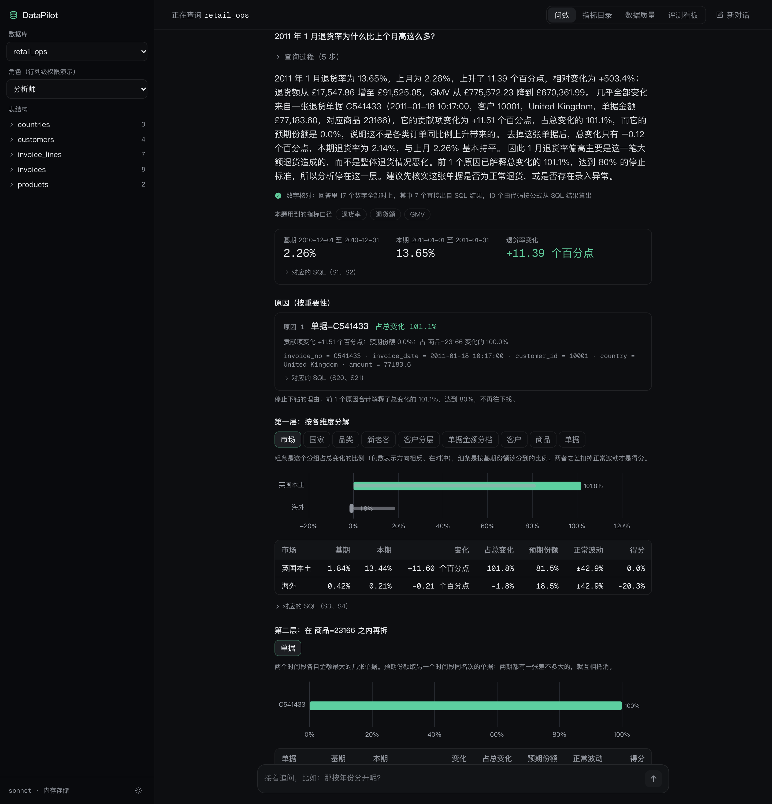
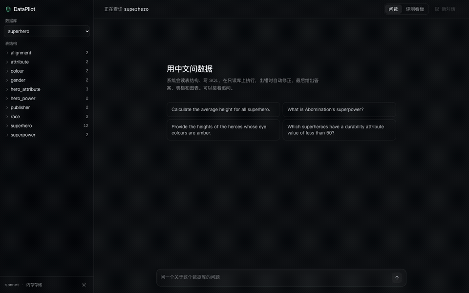
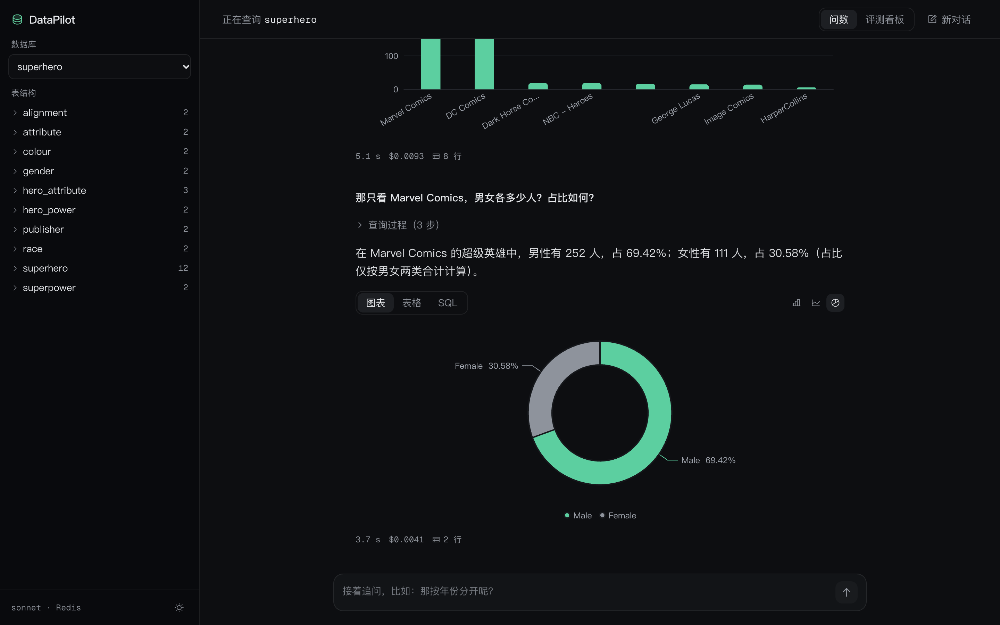
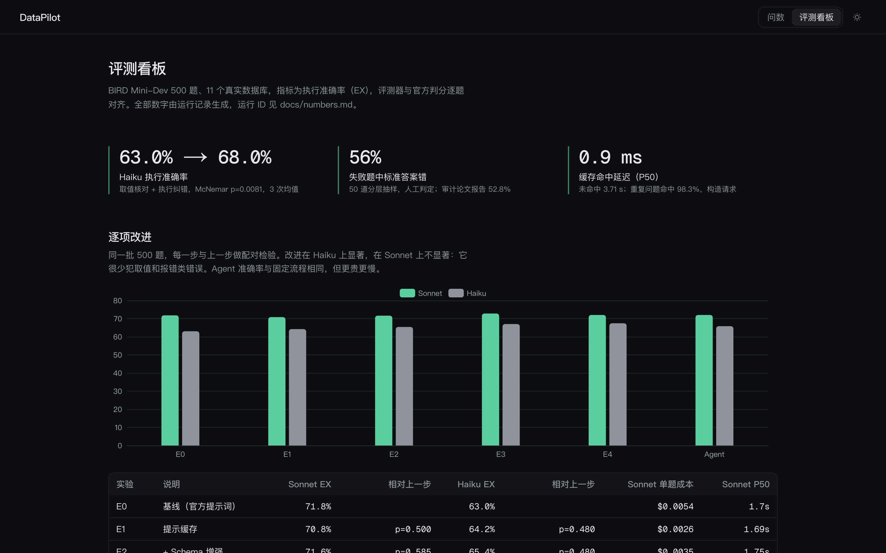
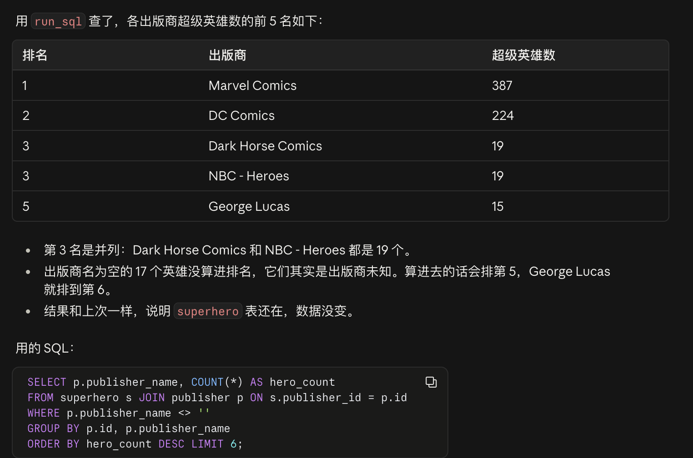

# DataPilot：经营问数与指标异动归因

[](https://github.com/kennywu411-dev/datapilot/actions/workflows/ci.yml)  

用中文问经营数据：能问"是多少"，也能问"为什么变了"。问一个数，系统写 SQL 查出来；问一个指标为什么变了，系统按国家、品类、客户、单据逐层拆开找原因，结论里的每个数字都能追溯到执行过的 SQL。

**[在线回放](https://kennywu411-dev.github.io/datapilot/)**：11 个问题的真实运行记录（3 个"为什么"、8 个"是多少"），逐步看分解、下钻、数字核对、生成的 SQL、纠错和行列级权限，以及每一步的耗时与花费，不用装环境。

| | |
|---|---|
| 给谁用 | 每周看数的经营负责人和运营：不会写 SQL，但需要知道"掉了多少"和"掉在哪" |
| 解决什么 | 问数工具只回答"是多少"；追问"为什么"时，通用做法是让模型自己看着数字说，说得对不对、数字哪来的都没有保证 |
| 怎么做 | 归因的分解、排序、下钻由 SQL 和代码完成，模型不做算术；回答里的每个数字逐个和 SQL 结果核对，对不上不输出；跑在真实交易数据上（UCI Online Retail II，107 万行） |

| 归因找得准不准 | 数字靠不靠得住 | 花多少钱 |
|---|---|---|
| 第一原因命中 31.8%（留出集 22 例，区间 16–53%）；让问数流程直接回答是 0% | 98 个回答、1,151 个数字 100% 能对上 SQL 结果或事实表；让模型自主下钻时只有 64–72% | 单次归因 $0.0007（Haiku），是自主 Agent 的 1/7；两者命中率没有显著差别 |

命中率不高，没有回避：真实数据里大客户、畅销品每个月本来就有进有出，量级和这种进出差不多的异常（大客户流失、单品断货），三种做法都找不到。详见下面"指标异动归因"一节和 [docs/numbers.md](docs/numbers.md)。



问数部分的重点不在功能多，而在每个选型都有对照实验：用固定流程还是 Agent、要不要 schema 检索、用哪个模型、要不要路由、要不要指标语义层，都在同一批题上做了配对检验。评测由 [evalkit](https://github.com/kennywu411-dev/evalkit) 运行和统计，所有数字和运行 ID 在 [docs/numbers.md](docs/numbers.md)。



## 主要结论

| 问题 | 结论 | 依据 |
|---|---|---|
| 固定流程还是 Agent | 固定流程。准确率一样，Agent 成本高 56%、延迟高 55% | BIRD 500 题，Sonnet 72.0% vs 72.0%，p=1.0 |
| 哪些改进有用 | 取值核对加执行纠错，Haiku 63.0% → 68.0%（p=0.008）；对 Sonnet 不显著 | 逐项消融，3 次运行 |
| 要不要 schema 检索 | schema 放得下就不要。准确率显著下降（p=0.013），成本 2.9 倍 | 373 题配对 |
| 用哪个模型 | Sonnet 72.4% 最高；qwen3.7-plus 68.0% 与 Haiku 67.4% 持平（p=0.81），单题 $0.0004 | 500 题 |
| 要不要路由 | Haiku 先答，触发纠错再升级 Sonnet：69.6%，成本是全用 Sonnet 的 14% | 离线回放 3 组，实跑一致 |
| 中文提问会不会掉分 | 不会，中英文没有显著差别 | BIRD 同批 100 题配对 |
| 企业问数难在哪 | 口径和元数据。去掉口径说明后，各模型从 93–98% 掉到 55–66%，换更强的模型也补不回来 | 模拟电商库 40 题 |
| 指标语义层有没有用 | 有。用户提问时自动匹配指标口径并注入，去口径题集上 Haiku 65.8% → 92.5%、Sonnet 64.2% → 95.0%；19 道新问法留出题 60–65% → 100% | 各 3 次运行，McNemar p ≤ 0.002 |
| 怎么防止查到敏感数据 | 行列级权限由代码强制，越权 0/170 | 46 个绕过测试，3 个角色 |
| 标准答案靠得住吗 | 失败题里 56% 是标准答案本身有问题（审计论文报告 52.8%） | 50 道人工判定 |
| "为什么变了"怎么答 | 固定下钻流程。第一原因命中和自主 Agent 没有显著差别（42.9% 对 38.8%，p = 0.73），成本是它的 1/4 到 1/7，数字 100% 可追溯（Agent 64–72%）；让问数流程直接回答只有 10–18% | 真实交易数据 49 例，留出 22 例只跑一次 |





## 架构

```
浏览器（Next.js + ECharts）
  │  SSE 推送：步骤 → SQL → 表格 → 图表 → 回答，15 秒心跳
  ▼
FastAPI ── Redis：会话（按用户隔离，保留最近 3 轮）、查询缓存、限流计数
  │         Redis 连不上时退回内存
  │  限流 429 → 缓存命中直接返回 → 未命中：信号量限制在途请求 ≤ 8，排队超时返回繁忙
  ▼
固定流程（LangGraph）
  generate → execute → check ──(报错 / 空结果 / 取值不存在)──→ correct，最多 3 次
  ▼
只读执行：sqlglot 只放行单条 SELECT → mode=ro 只读连接 → SQLite 授权回调
模型：Claude（Haiku / Sonnet / Opus）、DeepSeek 和通义千问（OpenAI 兼容接口）、Ollama 本地模型
MCP Server：list_tables / describe_table / search_values / run_sql，只读
指标语义层：指标字典（口径、计算、维度、同义词、血缘）→ 提问时匹配 → 口径注入生成 SQL
指标归因："为什么"类问题 → 计划（模型）→ SQL 分解 9 个维度 → 超额贡献排序 → 再拆一层 → 逐个剥离
          → 结论（模型）→ 数字核对；和问数共用限流、排队、缓存、行列级权限
数据质量：主键、重复、空值、枚举、范围、外键、业务规则、新鲜度检查
```

设计决策记录在 `docs/adr/`：[数据来源与评测口径](docs/adr/001-数据来源与评测口径.md)、[改进实验设计](docs/adr/002-改进实验设计.md)、[国产模型与中文评测](docs/adr/003-国产模型与中文评测.md)、[智能路由](docs/adr/004-智能路由.md)、[行列级权限](docs/adr/005-行列级权限.md)、[指标语义层与数据质量](docs/adr/006-指标语义层与数据质量.md)、[指标异动归因](docs/adr/007-指标异动归因.md)。

## 指标异动归因

用户问"2011 年 1 月退货率为什么比上个月高这么多"，流程是（[ADR 007](docs/adr/007-指标异动归因.md)）：

1. 模型把问题映射成"哪个指标、本期、基期"，代码校验。
2. SQL 算两个时间段的指标值和总变化。
3. 市场、国家、品类、新老客、客户分层、单据金额分档、客户、商品、单据 9 个维度各发 SQL，代码算每个分组占总变化的比例。
4. 排序看的是"超额"：占总变化的比例减去它按基期份额本该分到的比例，再扣掉它历史上的正常波动。英国常年占 GMV 的 85%，贡献了 85% 的下降不算原因；只占 2% 的德国贡献了 60% 才是。
5. 对排第一的原因再拆一层；找到一个原因就把它从数据里去掉，对剩余变化重复，最多 3 个。没有分组过门槛时如实说"没有突出的原因"。
6. 模型只把事实表写成结论；回答里的每个数字逐个和 SQL 结果、事实表核对，对不上重写一次，再不行改用模板。

这个例子的结果：全部变化来自一张退货单 C541433（£77,183.60），拿掉它之后 1 月退货率是 2.14%，和上月持平。这和[看板项目](https://github.com/kennywu411-dev/ecommerce-dashboard)人工分析的结论一致。

评测集 49 例：5 个真实案例（标准答案取自看板项目的分析产物）加 44 个注入异常（在库的副本里制造一个已知原因，如删掉某国某月的订单、插入几张大额退货单、某品类降价）。构造方法和判定标准在跑模型之前写好并提交，见 [evals/attribution/评测方案.md](evals/attribution/评测方案.md)。三种做法对照，留出集 22 例在方案冻结后只跑一次：

| 做法（Sonnet） | 第一原因命中 | 前三命中 | 数字能对上 SQL 结果 | 单次成本 | P50 耗时 |
|---|---|---|---|---|---|
| 问数流程直接回答 | 0/22 | 1/22 | 76.5% | $0.0093 | 5.3 s |
| 固定下钻流程 | 7/22 = 31.8% | 8/22 | 100% | $0.0078 | 6.7 s |
| 模型拿 SQL 工具自主下钻 | 6/22 = 27.3% | 9/22 | 72.1% | $0.0288 | 12.0 s |

- 49 例合并：固定流程 42.9%、Agent 38.8%、直接回答 10.2%。固定流程和 Agent 没有显著差别（McNemar p = 0.73），两者都显著好于直接回答。
- Agent 的前三命中略高（53.1% 对 46.9%，不显著）：它每次报 2–3 个候选，固定流程解释到 80% 就停。
- 固定流程的命中和模型无关：换成 Haiku 同样是 21/49，单次 $0.0007。
- 留出集比 dev（51.9%）低，dev 上调过方案，有拟合成分；对外以留出集为准。
- 大客户流失、单品断货这几类，三种做法都找不到。

## 评测结果

BIRD Mini-Dev 500 题，指标是执行准确率（EX）。评测器和官方 `evaluation_ex.py` 逐题对齐过，三组自检共 1500 次判分没有不一致。

| 配置 | Sonnet | Haiku | 备注 |
|---|---|---|---|
| E0 基线（官方提示词） | 71.8% | 63.0% | |
| E1 提示缓存 | 70.8% | 64.2% | 准确率不变，Sonnet 成本降 51% |
| E2 schema 增强 | 71.6% | 65.4% | 不显著 |
| E3 取值核对 | 72.8% | 67.0% | 不显著 |
| E4 执行纠错（最终） | 72.4% ± 0.35 | 68.0% ± 0.72 | 3 次均值，Haiku 相对 E0 p=0.008 |
| Agent（模型自己调工具） | 72.0% | 65.8% | 与 E4 无差别，更贵更慢 |
| schema 检索 | 70.0%（373 题） | | 显著变差，成本 2.9 倍 |

模型对比（E4，500 题）：

| 模型 | EX | 单题成本 | P95 延迟 |
|---|---|---|---|
| Haiku | 67.4%（3 次均值 68.0%） | $0.0002 | 4.7 s |
| Sonnet | 72.0%（3 次均值 72.4%） | $0.0035 | 8.6 s |
| qwen3.7-plus | 68.0% | $0.0004 | 6.7 s |
| deepseek-flash | 66.8% | $0.0013 | 28.5 s |
| qwen2.5-coder:7b（本地） | 53.8% | 0 | |
| Opus | 86.4% | $0.0057 | 4.2 s |

Opus 的分数不作为能力结论：500 条预测里有 241 条和标准答案逐字相同，疑似训练数据污染（问题日志 P7）。国产模型的成本按标价估算。

路由：

| 方案 | EX | 成本（全用 Sonnet = 100%） |
|---|---|---|
| 全用 Haiku | 68.0% | 7% |
| 路由（实跑） | 69.6% | 14% |
| 全用 Sonnet | 72.4% | 100% |
| 理想路由（预先知道哪题会错） | 77.5% | 42% |

Haiku 的错题大多执行成功、没有报错，运行时看不出来，所以路由只追回了差距的三分之一。

口径消融（模拟电商库 40 题）：口径写清楚时 Haiku 95.8%、Sonnet 97.5%、DeepSeek 95.0%、qwen 92.5%；去掉口径说明后是 65.8%、64.2%、62.5%、55.0%。

## 指标语义层与数据质量

企业问数的瓶颈在口径：同样问"销售额"，含不含退款、按下单还是签收算，结果完全不同。真实用户提问时不会附带口径说明，所以口径要由系统维护（[ADR 006](docs/adr/006-指标语义层与数据质量.md)）。

- 指标字典 `src/datapilot/metrics/shop_ops.yaml`：16 个指标、7 个业务术语、5 条通用约定（时间归属、天数差、金额分档、同比环比），每个指标写明口径、计算 SQL 片段、可用维度、同义词和依赖的表与列。
- 提问时用同义词加模糊检索匹配指标，把口径交给生成 SQL 的模型；回答里列出"本题用到的指标定义"，可以点开看口径。和行列级权限兼容，受限角色看不到依赖敏感列的指标。
- 指标目录页：列出全部指标、口径、维度和血缘，按角色标出不可用的指标。
- 数据质量检查：电商库 42 项检查，命令行、接口和页面都能看。在库的副本上注入 13 类缺陷，全部检出，干净库 0 误报。

| 题集 | 模型 | 无语义层 | 口径注入 | 语义层直接生成 SQL |
|---|---|---|---|---|
| 去口径 40 题 | Haiku | 65.8% | 92.5% | 87.5% |
| 去口径 40 题 | Sonnet | 64.2% | 95.0% | 90.0% |
| 新问法留出 19 题 | Haiku | 64.9% | 100% | 100% |
| 新问法留出 19 题 | Sonnet | 59.6% | 100% | 100% |

指标匹配：原 40 题精确率 94.9%、召回率 92.5%；留出 19 题精确率 94.1%、召回率 84.2%。直接生成 SQL 的方式一旦把问题映射错就没有纠错机会，所以默认用口径注入。留出题由同一人编写、已到上限，只作为"没有只拟合原题"的证据。

## 行列级权限

在 SQL 执行前按角色限制能看到的列和行，叠加在只读防护之上（[ADR 005](docs/adr/005-行列级权限.md)）。电商库有 3 个角色：分析师看全部；运营看不到成本价和客户姓名；上海区域经理在运营的基础上，只能看上海的用户、订单和售后。

- 主防线是语法树改写：sqlglot 解析后，把每一处受限表引用（包括别名、子查询、JOIN、UNION、CTE 内部）换成只含可见列、带行过滤的子查询。直接引用敏感列会被拒绝并说明原因，无法解析的 SQL 一律拒绝。
- 兜底是 SQLite 授权回调：每读一列都会检查，就算改写有漏洞，敏感列也读不出来。
- 表结构和样例只展示可见部分，`search_values` 不能用来探测敏感值，缓存 key 带角色。
- 角色由请求头 `X-Role` 传入，只用于演示，生产环境应由网关按登录身份填写。MCP 的角色由启动环境固定，模型改不了。

| 评测 | 带权限说明 | 不带权限说明 |
|---|---|---|
| 越权次数 | 0 / 102 | 0 / 68 |
| 需要无权限数据时如实告知 | 16 / 16 | 8 / 16 |
| 区域经理的回答说明了权限范围 | 26 / 26 | 4 / 26 |

越权为 0 靠的是代码。能不能如实告知，取决于有没有把权限范围告诉模型：不告诉的话，区域经理问"北京用户下了多少单"会得到"0 单"，看起来像事实（问题日志 P19）。

## 并发与多用户

- 限流：前端为每个浏览器生成匿名 id，放在 `X-User-Id`（没有时按 IP），每分钟固定窗口计数，Redis 里用 INCR 加 EXPIRE NX 事务。上限 20 时，第 21 次返回 429。
- 隔离：会话 key 和会话锁都带用户 id，查询缓存按库共享。
- 并发保护：只有未命中缓存的请求占名额，在途最多 8 个，排队超过 10 秒返回"系统繁忙"。名额满时先推一个"排队等待"事件，首个事件延迟 P50 从 10.55 s 降到 0.016 s（问题日志 P14）。

压测用模拟模型（每次调用固定 1.5 秒，不调 API）：缓存命中路径 100 并发 P95 197 ms、0 错误；未命中路径吞吐 2.6–2.7/s，正好是名额 8 除以单题 3 秒的理论上限，50 并发时 36% 的请求被拒，下游没有被打穿。

```bash
DATAPILOT_MODEL=simulated DATAPILOT_SIM_LATENCY_S=1.5 REDIS_URL=redis://localhost:6379/2 \
  uv run uvicorn datapilot.api:app --port 8010
uv run python scripts/load_test.py --base http://127.0.0.1:8010
```

信号量和会话锁只在单进程内有效，多 worker 部署时要换成 Redis 上的分布式实现。

## 运行

需要 Python 3.12（用 uv 管理）、Node 20+，Redis 可选。

```bash
uv sync
npm --prefix web install
uv run python scripts/download_data.py      # BIRD Mini-Dev，数据库约 801MB
uv run python scripts/gen_shop_ops.py       # 可选：模拟电商库 shop_ops（口径消融、行列级权限演示用）
uv run python scripts/add_database.py shop_ops data/source/shop_ops.sqlite
# 可选：真实交易库 retail_ops（归因用；UCI Online Retail II，原始文件约 45 MB，脚本会下载）
uv run --with pandas --with openpyxl python scripts/build_retail_ops.py --download
uv run python scripts/add_database.py retail_ops data/source/retail_ops.sqlite
cp .env.example .env                        # 填 ANTHROPIC_API_KEY；不填也能启动，问数会报「未设置 ANTHROPIC_API_KEY」

uv run pytest -q
uv run uvicorn datapilot.api:app --port 8000
npm --prefix web run dev                    # http://localhost:3000
```

后端接口都在 `/api/*` 下（健康检查 `GET /api/health`）；前端通过环境变量 `NEXT_PUBLIC_API_BASE` 找后端，默认 `http://localhost:8000`。没有 Redis 时服务自动退回内存存储，`uv run pytest -q` 会跳过 6 个需要 Redis 的测试，其余照常通过。

Docker：先下载数据，再 `docker compose up --build`，打开 http://localhost:3000。数据目录只读挂载，不打进镜像。

跑评测（不加 `--yes` 只打印预估花费）：

```bash
uv run python evals/runner.py --models sonnet,haiku --pipeline e4_correct --max-cost 3 --yes
uv run python evals/compare.py <run_a> <run_b> --model haiku
uv run python scripts/build_dashboard.py
uv run python evals/attribution_eval.py --ablation --split dev    # 归因：不花钱比较下钻方案
uv run python evals/attribution_eval.py --split dev --models sonnet --max-cost 2 --yes
```

## MCP Server

`.mcp.json` 已配好，任何 MCP 客户端都能接入，接入后可以直接问"superhero 库里各出版商有多少英雄"。不接客户端也能验证：

```bash
uv run python scripts/mcp_smoke.py   # 拉起服务，列工具、查询，确认 DROP 被拒
```



删表请求在数据库一侧就会被拒：sqlglot 只放行单条 SELECT，连接是只读的，授权回调只放行读操作。不依赖模型自己拒绝，也不依赖客户端的安全检查。

## 其他文档

- [docs/numbers.md](docs/numbers.md)：全部数字和运行 ID
- [docs/问题日志.md](docs/问题日志.md)：开发中遇到的问题、排查过程和修复
- [docs/failure/判定表.md](docs/failure/判定表.md)：50 道失败题的判定
- [docs/roi.md](docs/roi.md)：ROI 测算
- [evalkit](https://github.com/kennywu411-dev/evalkit)：评测平台，本项目的评测运行、配对检验、门禁和看板都由它提供
- [docs/接入新数据库.md](docs/接入新数据库.md)：接入一个新库并评测的步骤
- [CHANGELOG.md](CHANGELOG.md)

## 局限

- 归因的第一原因命中只有三成到五成（留出集 31.8%，区间 16–53%；dev 51.9%），评测集 49 例，只能检出大差距，三种做法各只跑了 1 次。
- 归因评测的标准答案大多是注入的，真实案例只有 5 例。注入题的入选规则和默认排序方法用的是同一类统计量。第一版评测集的标准答案站不住，重做过一次（问题日志 P23）。
- 归因只支持可加指标及其比率和差，只比较两个时间段；"新老客"维度在数据起点附近失真（[docs/badcases.md](docs/badcases.md) 第 4 个）。
- 问数的评测数据来自公开基准 BIRD Mini-Dev 和一个固定种子生成的模拟电商库；归因用的是 UCI Online Retail II 公开数据（CC BY 4.0），一家公司两年的交易，不代表行业水平。
- 缓存和压测的请求是构造的，压测用的是模拟模型，客户端和服务端在同一台机器上。
- 用户身份是前端生成的匿名 id，换一个就能绕过限流。真正防滥用需要网关校验身份。
- "真实准确率约 90%"是根据 50 道人工判定外推的估计值。
- 国产模型走 JSON 模式，Claude 用结构化输出，提示方式不完全一样；国产模型的结论来自单次运行。

## 数据与许可

代码使用 MIT 许可。BIRD Mini-Dev（https://github.com/bird-bench/mini_dev）使用 CC BY-SA 4.0，数据库和题目不随代码分发，由 `scripts/download_data.py` 下载；`runs/` 和 `web/src/data/eval.json` 里含部分题目原文和模型输出，同样按 CC BY-SA 4.0 署名使用。`third_party/bird_eval/` 是官方评测脚本原件，只用于逐题对照。
